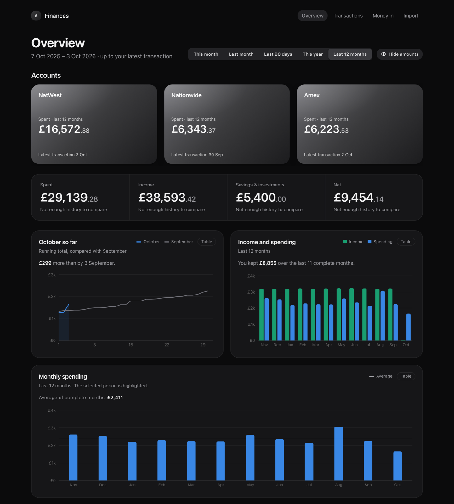

# Finances No MI

See what you actually spend each month across your bank accounts.

Bank apps count every payment out as spending and every payment in as income. Moving money between your own accounts, putting money into savings and friends paying you back all end up in the totals, so they rarely match what you really spent.

Finances No MI imports OFX statements from Amex, Nationwide and NatWest into one place. You mark those transfers, savings and repayments once, and the totals show your real spending.

It runs only on your machine, so your statements never leave it. To try it with synthetic data, run `pnpm demo` after [setup](#setup).

Built with FastAPI, SQLAlchemy, SQLite, React, TypeScript and Playwright.



## Repository layout

```text
apps/
  api/    FastAPI and SQLite backend
  web/    React frontend
docs/     Architecture records
```

## Requirements

- Node.js 24+
- pnpm 12+
- Python 3.11+
- uv

## Setup

```bash
pnpm install
cd apps/api
uv sync --group dev
uv run alembic upgrade head
```

## Development

Start the API and frontend together against the local database:

```bash
pnpm dev
```

This runs migrations, starts the API on port 8000, and starts the frontend at
`http://localhost:5173`. The default database is `.data/finances.db`.

To run the API and frontend separately, start the API from `apps/api`:

```bash
uv run uvicorn finances_api.main:app --reload
```

Run the frontend from the repository root:

```bash
pnpm --filter web dev
```

After importing statements, open **Transactions** to search them and mark how selected ones count, for example contributions to an investment account as Savings & investments. Open **Money in** to choose how money from each payer counts: income, a repayment that reduces spending, or a transfer from your own account.

The Vite dev server proxies `/api` requests to the API at `http://127.0.0.1:8000`. Import OFX statements from the **Import** page. The first statement for a new account asks which account it is; later statements for that account import directly.

Run the isolated browser tests:

```bash
pnpm --filter web exec playwright install chromium
pnpm --filter web test:e2e
```

Playwright starts only the frontend. API and external network requests are blocked unless a test explicitly provides a synthetic response.

Open the report, including a screenshot of each tested state:

```bash
pnpm --filter web exec playwright show-report
```

To click through the app with synthetic data, run from the repository root:

```bash
pnpm demo
```

This recreates `.data/demo.db` with synthetic statements for all three banks, then starts the API on port 8001 and the frontend at `http://localhost:5173`. It never reads your real database. Stop it with Ctrl+C.

For interactive browser exploration, start the frontend and use the project-local CLI in another terminal:

```bash
pnpm --filter web browser open http://127.0.0.1:5173
```

Local application data is stored under `.data/` and must never be committed.

## Documentation

- [Product](docs/product.md)
- [Architecture](docs/architecture.md)
- [Roadmap](docs/roadmap.md)
- [OFX imports](docs/features/ofx-imports.md)
- [Money in](docs/features/money-in.md)
- [Backlog](docs/backlog.md)
- [Transaction categorization](docs/features/transaction-categorization.md) (paused)
- [Categorization evals with LangChain and LangSmith](docs/evals.md)
